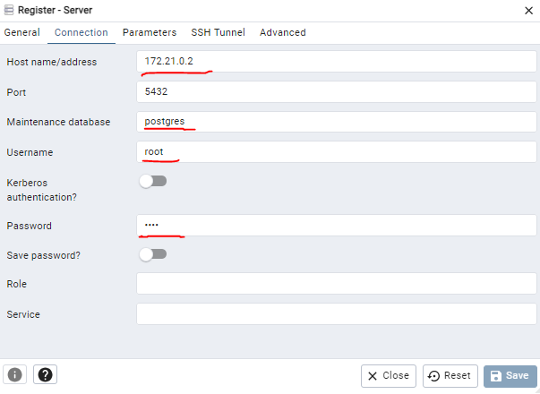
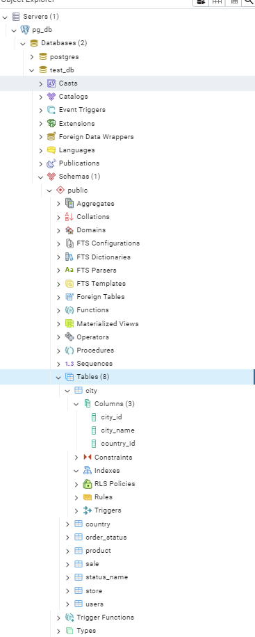

# Steps

## Step 1 - Run the docker compose

Your Docker Compose is ready! 🚀

In the root of your project repository, type the following command to install the dependencies and run your database:

`docker-compose up` or detached `docker-compose up -d`

## Step 2 - Configure PG Admin

`docker container ls`

```sh
    40e28375d285   dpage/pgadmin4    "/entrypoint.sh"         4 minutes ago   Up 4 minutes   443/tcp, 0.0.0.0:5050->80/tcp   pgadmin4_container
    0d27cfc4f914   postgres:latest   "docker-entrypoint.s…"   6 minutes ago   Up 4 minutes   0.0.0.0:5432->5432/tcp          postgres_container 
```

Find the IP iddress of the postgres:latest:

`docker inspect 0d27cfc4f914`

Example:

```sh
    "NetworkSettings.Networks.IPAddress": "172.19.0.2", 
```

Now go to http://localhost:5050 and select 'Add New Server' name it 'pg_db' under General then and modify the Connection to match the docker-compose configuration:



Thats it. You should be able to find the database configured in the docker-compose under schema as seen in this figure:



## Step 3 - Stop the docker compose

One of the advantages of using Docker Compose for Postgres is to avoid background processes on your computer. When you finish working on your project, I recommend you to stop the running Postgres Docker container using the command below:

`docker-compose down` 